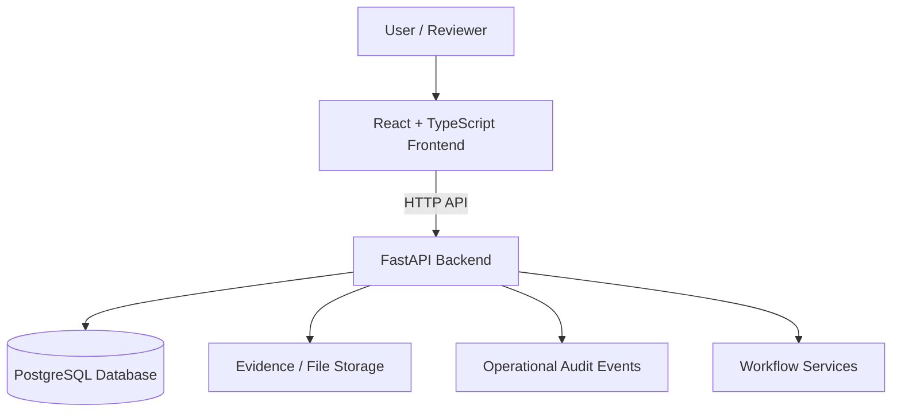

# PRAVAAH
### Enterprise Autonomous Transformation — Approval Workflow Automation & Compliance Monitoring

PRAVAAH is a prototype platform for organising approval workflows, supporting evidence-based reviews, tracking compliance obligations, and maintaining an operational history of key actions. It is designed to demonstrate how a structured digital workspace can help teams manage application records and compliance activities more consistently.

> **Project status:** Academic / hackathon prototype. PRAVAAH is not an official AICTE service, does not issue official approvals, and must not be treated as a substitute for applicable regulations or authorised human review. Demonstration data should be synthetic.

## Table of contents
- [Problem context](#problem-context)
- [Objectives](#objectives)
- [Platform capabilities](#platform-capabilities)
- [Roles and workflow](#roles-and-workflow)
- [Architecture](#architecture)
- [Technology stack](#technology-stack)
- [Run locally](#run-locally)
- [Configuration](#configuration)
- [API overview](#api-overview)
- [Security and data handling](#security-and-data-handling)
- [Testing and verification](#testing-and-verification)
- [Repository structure](#repository-structure)

## Problem context
Approval and compliance processes can involve multiple stakeholders, policy requirements, supporting documents, review stages, deadlines, and follow-up actions. When these activities are spread across separate records and communication channels, it becomes harder to understand application status, identify missing evidence, and follow up on obligations.

PRAVAAH demonstrates a centralised workflow where application information, evidence review, policy metadata, obligations, readiness information, notifications, and audit events can be managed from one workspace.

## Objectives
- Centralise application and review information in a consistent workflow.
- Make evidence requirements and review outcomes easier to track.
- Organise compliance obligations and follow-up actions.
- Present role-oriented views for operational work.
- Provide a traceable record of relevant application and compliance events.
- Demonstrate a modular frontend and backend architecture that can be extended and tested.

## Platform capabilities

PRAVAAH brings application workflow, evidence review, policy version metadata, compliance obligations, undertakings, readiness assessment, operational metrics, and audit integrity checks into a unified role-oriented workspace. The capabilities below describe the current implementation and its demonstrated behaviour.

| Capability | Implementation | Current behaviour |
|---|---|---|
| Application workflow | **Implemented** | Authenticated application creation, listing, detail views, and supported workflow transitions. |
| Authentication and role-based access | **Implemented** | Login, authenticated profile lookup, and role/region-scoped authorisation. |
| Policy register and version metadata | **Implemented** | Policy metadata listing and administrator-managed policy versions for workflow reference. |
| Evidence management | **Implemented** | PDF/JPEG/PNG upload paths, evidence metadata, digest storage, and review actions. Storage configuration and operational safeguards depend on deployment settings. |
| Compliance obligations | **Implemented** | Obligation creation, filtering, status updates, audit events, and API-triggered overdue escalation. |
| In-app notifications | **Implemented** | Escalation can queue in-app notifications, and users can retrieve their notification inbox. Delivery is through the application inbox; external email/SMS delivery is not represented as enabled. |
| Undertakings | **Implemented** | Application-linked undertaking drafting, submission, and review workflows. |
| EVC readiness assessment | **Implemented** | Point-in-time snapshots summarise evidence, open obligations, and unaccepted undertakings to support human review. |
| Rule-based recommendations | **Implemented** | Transparent workflow rules identify defined evidence gaps, review states, overdue obligations, and unaccepted undertakings, with factors and suggested actions. |
| Operational metrics | **Implemented** | Role/region-scoped workflow counts and overdue-obligation summaries. |
| Audit event history | **Implemented** | Operational audit events can be queried to support traceability and review. |
| Audit-chain integrity verification | **Implemented and live-demo verified** | Administrator verification checks event hashes and links, then compares the calculated chain head with the stored chain head. The live demonstration on 31 October 2026 reported **5 events checked, chain head Matches, first invalid event None**. |
| Demonstration dataset | **Available for evaluation** | Five clearly identified synthetic audit records support repeatable demonstration of the verification workflow. |

### Verification evidence

The `nithin-pravaah` branch has successful GitHub Actions runs recorded for commit `e99463b1` on 31 October 2026:

- [Frontend CI — passed](https://github.com/sainithinreddy06/PRAVAAH/actions/runs/41222661389): dependency installation, TypeScript typecheck, lint, and production build.
- [Backend CI — passed](https://github.com/sainithinreddy06/PRAVAAH/actions/runs/41222661453): PostgreSQL migrations, `pytest`, and Ruff lint.
- [Earlier backend CI run — passed](https://github.com/sainithinreddy06/PRAVAAH/actions/runs/41221432068).

The live audit-chain result is a separate deployed-workspace demonstration. CI success verifies the checks run by those workflows; it is not a claim that every feature has undergone a separate end-to-end production test.

## Roles and workflow
The current build provides role-oriented access for users involved in submitting, reviewing, administering, or monitoring workflow records. API authorisation applies role and, where relevant, regional scope.

A typical workflow is:

1. Create an application record and move it through supported state transitions.
2. Associate evidence and policy metadata.
3. Review evidence and record findings.
4. Track obligations and undertakings; trigger overdue-obligation escalation when required.
5. Generate an EVC readiness snapshot or request rule-based recommendations for human review.
6. Consult operational metrics and audit history; administrators can run the audit-chain integrity check.

The platform combines these capabilities in a role-oriented workflow; the verification links above provide automated build/test evidence, while the audit-chain result reflects the live demonstration.

## Architecture



The frontend provides the user interface, while the FastAPI backend exposes application functionality and coordinates workflow operations. SQLAlchemy and Alembic support database access and schema migrations. The deployed configuration may differ from a local development setup.

## Technology stack

| Layer | Technologies |
|---|---|
| Frontend | React, TypeScript, Vite |
| Backend | Python, FastAPI |
| Data access | SQLAlchemy |
| Database migrations | Alembic |
| Database | PostgreSQL for the intended deployment configuration; SQLite may be used in selected tests |
| API format | HTTP endpoints with JSON where applicable |
| Deployment | Render services; Docker for the backend deployment |

Check the repository's dependency and configuration files for the exact versions used by the current branch.

## Run locally

### Prerequisites
- Git
- Node.js and npm compatible with the frontend lockfile
- Python version supported by the backend dependency configuration
- PostgreSQL, or the database configured for your local/test environment
- Docker and Docker Compose if using the container workflow

### 1. Clone the repository
```bash
git clone https://github.com/sainithinreddy06/PRAVAAH.git
cd PRAVAAH
git switch nithin-pravaah
```

### 2. Configure the backend
Open a terminal in the repository root, then:
```bash
cd backend
python -m venv .venv
```

Activate the virtual environment:

**Windows PowerShell**
```powershell
.\.venv\Scripts\Activate.ps1
```

**macOS / Linux**
```bash
source .venv/bin/activate
```

Install the backend requirements using the dependency file present in `backend/`. For example, if the repository provides `requirements.txt`:
```bash
python -m pip install -r requirements.txt
```

Set the environment variables required by the backend, configure a local database, and run migrations using the repository's Alembic configuration. Then start the API using the entry point documented in the backend configuration. A common FastAPI development command, when the module is named `main.py`, is:
```bash
uvicorn main:app --reload
```

Do not assume this example module name applies if the current backend entry point differs.

### 3. Start the frontend
Open a second terminal at the repository root:
```bash
cd frontend
npm ci
npm run dev
```

Use the local URL printed by Vite. Configure the frontend API base URL to point to the local backend before testing API-backed screens.

### 4. Docker workflow
If a Docker Compose file is present in the checked-out branch, review its services and required environment variables, then start the configured stack:
```bash
docker compose up --build
```

Use the Compose file as the source of truth for service names, ports, database initialization, and migrations. Do not run both Docker and manual services on the same ports at the same time.

## Configuration
Use the repository's example environment file, if provided, as the starting point. Typical settings in a project of this architecture may include:

- Database connection string
- Application environment and logging level
- API host and port
- Frontend API base URL
- CORS allowed origins
- Evidence/file storage location
- Authentication or session configuration, if enabled

Names and required values vary by branch; verify them against the actual settings code and deployment configuration. Never commit real credentials, private keys, production database passwords, or personal data. Use environment variables or the hosting provider's secret settings.

## API overview
The backend exposes HTTP endpoints for the workflow areas enabled in the current build. Depending on the implementation, these may include:

- Health or service status
- Applications and review workflow
- Policy metadata
- Evidence and review records
- Obligations and undertakings
- Readiness snapshots and recommendations
- Notifications
- Audit-event queries
- Operational metrics

For exact routes, request schemas, response formats, and authentication requirements, inspect the backend route definitions and the API documentation served by the running FastAPI instance (commonly `/docs` when enabled). This README intentionally does not promise endpoint paths that have not been verified against the active branch.

## Security and data handling
- Use synthetic data for demos and evaluation unless appropriate authorisation and safeguards are in place.
- Keep secrets in environment variables or deployment secret stores; never put them in source control.
- Restrict CORS to the frontend origins required by the environment.
- Apply authentication and role-based authorisation appropriate to the deployment before exposing sensitive workflows.
- Validate uploads and inputs, enforce file size/type limits, and control access to stored evidence.
- Avoid logging passwords, tokens, confidential documents, or unnecessary personal information.
- Back up the database and define retention and access policies before any real operational use.
- Treat audit events as application-level records unless independent tamper-resistance has been implemented and verified.

## Testing and verification
Run the tests and checks defined by the current branch and its configuration. Common examples, when corresponding scripts or configuration are present, include:

```bash
# Frontend
npm ci
npm run typecheck
npm run build

# Backend
python -m pytest
```

Use the actual script names in `package.json` and the backend test configuration; commands above are examples and may need adjustment. A successful unit-test run does not by itself verify every end-to-end workflow, a production database, deployment configuration, or external integrations. Record fresh test results before presenting them as verified.

## Repository structure
The repository is organised around a frontend and backend. Exact paths can change between branches.

- `frontend/` — React/TypeScript user interface.
- `backend/` — FastAPI application, workflow logic, database access, and tests.
- Database migration files and deployment configuration — schema evolution and runtime setup.
- Documentation and environment examples — project setup and developer guidance, where present.


## Project links
- **Repository:** https://github.com/sainithinreddy06/PRAVAAH
- **Target development branch:** `nithin-pravaah`

---

**PRAVAAH — structured workflows, evidence visibility, and compliance operations.**
