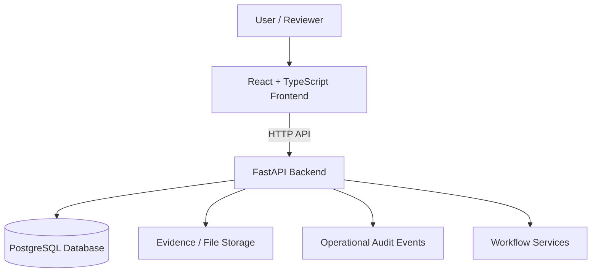

# PRAVAAH
### Enterprise Autonomous Transformation — Approval Workflow Automation & Compliance Monitoring

PRAVAAH is a prototype platform for organising approval workflows, supporting evidence-based reviews, tracking compliance obligations, and maintaining an operational history of key actions. It is designed to demonstrate how a structured digital workspace can help teams manage application records and compliance activities more consistently.

> **Project status:** Academic / hackathon prototype. PRAVAAH is not an official AICTE service, does not issue official approvals, and must not be treated as a substitute for applicable regulations or authorised human review. Demonstration data should be synthetic.

## Table of contents
- [Problem context](#problem-context)
- [Objectives](#objectives)
- [Implementation status matrix](#implementation-status-matrix)
- [Roles and workflow](#roles-and-workflow)
- [Architecture](#architecture)
- [Technology stack](#technology-stack)
- [Run locally](#run-locally)
- [Configuration](#configuration)
- [API overview](#api-overview)
- [Security and data handling](#security-and-data-handling)
- [Testing and verification](#testing-and-verification)
- [Repository structure](#repository-structure)
- [Known limitations](#known-limitations)
- [Future scope](#future-scope)

## Problem context
Approval and compliance processes can involve multiple stakeholders, policy requirements, supporting documents, review stages, deadlines, and follow-up actions. When these activities are spread across separate records and communication channels, it becomes harder to understand application status, identify missing evidence, and follow up on obligations.

PRAVAAH demonstrates a centralised workflow where application information, evidence review, policy metadata, obligations, readiness information, notifications, and audit events can be managed from one workspace.

## Objectives
- Centralise application and review information in a consistent workflow.
- Make evidence requirements and review outcomes easier to track.
- Organise compliance obligations and follow-up actions.
- Present role-oriented views for operational work.
- Provide a traceable record of relevant application and compliance events.
- Demonstrate a modular frontend and backend architecture that can be extended and tested.

## Implementation status matrix

Status is based on the implementation in `nithin-pravaah`, the repository's automated CI runs, and the live audit-verification demonstration observed on 31 October 2026. “Working” means the code path and relevant automated checks are present and CI passed; it does not mean the feature is production-certified. “Partially working” identifies a functioning subset with explicit limitations. “Simulated” means demonstration/sample data or a non-production approximation. “Planned” means it should not be presented as available today.

| Capability | Status | What works today | Evidence / limitation |
|---|---|---|---|
| Application workflow | **Working** | Authenticated application create/list/detail and state transitions are implemented. | Backend CI passed; application API tests are in `backend/tests/test_applications.py`. Role and transition rules are enforced in the API. |
| Authentication and role access | **Working** | Login, authenticated profile lookup, and role/region checks are implemented. | Backend CI passed; see `backend/tests/test_auth.py` and authorization coverage across workflow tests. |
| Policy register / policy metadata | **Working** | Policy metadata can be listed; platform administrators can create policy versions. | Implemented in the policy API and covered by the backend test suite. Metadata is not a guarantee that a policy is official or current. |
| Evidence upload and review | **Partially Working** | PDF/JPEG/PNG evidence upload, metadata listing, digest storage, and review actions are implemented. | Backend CI passed; see evidence storage and upload-boundary tests. Production use requires correctly configured private storage and malware scanning; retention/quarantine operations still have limitations. |
| Compliance obligations | **Working** | Obligations can be created, listed with filters, and updated with audit events. Due obligations can be escalated through an API call. | Backend CI passed; see `backend/tests/test_obligations.py`. Escalation is API-triggered, not a scheduled background process. |
| In-app notifications | **Partially Working** | Overdue-obligation escalation can queue in-app notifications and users can retrieve their inbox. | Covered by the backend test suite, including notification-worker regression tests. A queued notification is not a delivered message; email/SMS delivery and automatic scheduling are not implemented. |
| Undertakings | **Working** | Application-linked undertakings can be drafted, submitted, and reviewed. | Backend CI passed; see EVC and authorization regression tests. Human review remains required. |
| EVC readiness snapshots | **Partially Working** | An assessment snapshot can summarise evidence, open obligations, and unaccepted undertakings. | Implemented under the EVC API and tested in `backend/tests/test_evc.py`. It is a point-in-time readiness indicator, not an official compliance verdict; create a new snapshot after underlying records change. |
| Rule-based recommendations | **Partially Working** | The API evaluates defined evidence gaps, evidence review states, due/overdue obligations, and unaccepted undertakings, returning factors and suggested actions. | Implemented in the recommendations API. It is a transparent heuristic, not a trained prediction model or official AICTE scoring rubric; validate advice against authoritative requirements. |
| Operational metrics | **Working** | The API returns workflow counts and overdue-obligation summaries with role/region scoping. | Backend CI passed; see `backend/tests/test_operations.py`. Metrics are operational summaries, not regulatory determinations. |
| Audit event history and integrity verification | **Working (demo verified)** | Audit events are queryable; the administrator integrity endpoint checks event hashes/links and compares the calculated chain head with the stored head. | Backend CI passed, including audit-integrity tests in `backend/tests/test_compliance.py`. The live demo on 31 Oct 2026 reported **5 events checked, chain head Matches, first invalid event None**. This verifies the checked stored chain; it does not prove every real-world action was captured or that event content is truthful. |
| Demo audit records | **Simulated** | Five clearly illustrative audit records are available for showing the integrity-verification flow. | These are synthetic records, not real institution activity. Do not present them as real applications or official actions. |
| Scheduled jobs and email/SMS delivery | **Planned** | No automatic scheduler or external message-delivery pipeline is claimed as available. | Current escalation is API-triggered; add and test scheduling, delivery, retry, and alerting before claiming end-to-end delivery. |
| Official AICTE / external-system integration and approval authority | **Planned** | No official integration or authority to issue regulatory approvals is claimed. | PRAVAAH is an academic/hackathon prototype and does not replace authorised human review. |

### Latest automated test evidence

The latest GitHub Actions runs for `nithin-pravaah` at the time this matrix was written were green on commit `e99463b1` (31 October 2026):

- [Frontend CI — passed](https://github.com/sainithinreddy06/PRAVAAH/actions/runs/41222661389): dependency installation, TypeScript typecheck, lint, and production build.
- [Backend CI — passed](https://github.com/sainithinreddy06/PRAVAAH/actions/runs/41222661453): PostgreSQL migrations, `pytest`, and Ruff lint.
- [Backend CI — preceding run passed](https://github.com/sainithinreddy06/PRAVAAH/actions/runs/41221432068).

These are repository CI results, not a claim that every row has a dedicated end-to-end test. The live audit result is separately identified above as a demonstration observed in the deployed workspace. Check the linked Actions runs for the full job logs and rerun CI after future code changes.

## Roles and workflow
The current build provides role-oriented access for users involved in submitting, reviewing, administering, or monitoring workflow records. API authorisation applies role and, where relevant, regional scope.

A typical workflow is:

1. Create an application record and move it through supported state transitions.
2. Associate evidence and policy metadata.
3. Review evidence and record findings.
4. Track obligations and undertakings; trigger overdue-obligation escalation when required.
5. Generate an EVC readiness snapshot or request rule-based recommendations for human review.
6. Consult operational metrics and audit history; administrators can run the audit-chain integrity check.

See the implementation status matrix above for working paths, known limitations, simulated records, and planned capabilities.

## Architecture



The frontend provides the user interface, while the FastAPI backend exposes application functionality and coordinates workflow operations. SQLAlchemy and Alembic support database access and schema migrations. The deployed configuration may differ from a local development setup.

## Technology stack

| Layer | Technologies |
|---|---|
| Frontend | React, TypeScript, Vite |
| Backend | Python, FastAPI |
| Data access | SQLAlchemy |
| Database migrations | Alembic |
| Database | PostgreSQL for the intended deployment configuration; SQLite may be used in selected tests |
| API format | HTTP endpoints with JSON where applicable |
| Deployment | Render services; Docker for the backend deployment |

Check the repository's dependency and configuration files for the exact versions used by the current branch.

## Run locally

### Prerequisites
- Git
- Node.js and npm compatible with the frontend lockfile
- Python version supported by the backend dependency configuration
- PostgreSQL, or the database configured for your local/test environment
- Docker and Docker Compose if using the container workflow

### 1. Clone the repository
```bash
git clone https://github.com/sainithinreddy06/PRAVAAH.git
cd PRAVAAH
git switch nithin-pravaah
```

### 2. Configure the backend
Open a terminal in the repository root, then:
```bash
cd backend
python -m venv .venv
```

Activate the virtual environment:

**Windows PowerShell**
```powershell
.\.venv\Scripts\Activate.ps1
```

**macOS / Linux**
```bash
source .venv/bin/activate
```

Install the backend requirements using the dependency file present in `backend/`. For example, if the repository provides `requirements.txt`:
```bash
python -m pip install -r requirements.txt
```

Set the environment variables required by the backend, configure a local database, and run migrations using the repository's Alembic configuration. Then start the API using the entry point documented in the backend configuration. A common FastAPI development command, when the module is named `main.py`, is:
```bash
uvicorn main:app --reload
```

Do not assume this example module name applies if the current backend entry point differs.

### 3. Start the frontend
Open a second terminal at the repository root:
```bash
cd frontend
npm ci
npm run dev
```

Use the local URL printed by Vite. Configure the frontend API base URL to point to the local backend before testing API-backed screens.

### 4. Docker workflow
If a Docker Compose file is present in the checked-out branch, review its services and required environment variables, then start the configured stack:
```bash
docker compose up --build
```

Use the Compose file as the source of truth for service names, ports, database initialization, and migrations. Do not run both Docker and manual services on the same ports at the same time.

## Configuration
Use the repository's example environment file, if provided, as the starting point. Typical settings in a project of this architecture may include:

- Database connection string
- Application environment and logging level
- API host and port
- Frontend API base URL
- CORS allowed origins
- Evidence/file storage location
- Authentication or session configuration, if enabled

Names and required values vary by branch; verify them against the actual settings code and deployment configuration. Never commit real credentials, private keys, production database passwords, or personal data. Use environment variables or the hosting provider's secret settings.

## API overview
The backend exposes HTTP endpoints for the workflow areas enabled in the current build. Depending on the implementation, these may include:

- Health or service status
- Applications and review workflow
- Policy metadata
- Evidence and review records
- Obligations and undertakings
- Readiness snapshots and recommendations
- Notifications
- Audit-event queries
- Operational metrics

For exact routes, request schemas, response formats, and authentication requirements, inspect the backend route definitions and the API documentation served by the running FastAPI instance (commonly `/docs` when enabled). This README intentionally does not promise endpoint paths that have not been verified against the active branch.

## Security and data handling
- Use synthetic data for demos and evaluation unless appropriate authorisation and safeguards are in place.
- Keep secrets in environment variables or deployment secret stores; never put them in source control.
- Restrict CORS to the frontend origins required by the environment.
- Apply authentication and role-based authorisation appropriate to the deployment before exposing sensitive workflows.
- Validate uploads and inputs, enforce file size/type limits, and control access to stored evidence.
- Avoid logging passwords, tokens, confidential documents, or unnecessary personal information.
- Back up the database and define retention and access policies before any real operational use.
- Treat audit events as application-level records unless independent tamper-resistance has been implemented and verified.

## Testing and verification
Run the tests and checks defined by the current branch and its configuration. Common examples, when corresponding scripts or configuration are present, include:

```bash
# Frontend
npm ci
npm run typecheck
npm run build

# Backend
python -m pytest
```

Use the actual script names in `package.json` and the backend test configuration; commands above are examples and may need adjustment. A successful unit-test run does not by itself verify every end-to-end workflow, a production database, deployment configuration, or external integrations. Record fresh test results before presenting them as verified.

## Repository structure
The repository is organised around a frontend and backend. Exact paths can change between branches.

- `frontend/` — React/TypeScript user interface.
- `backend/` — FastAPI application, workflow logic, database access, and tests.
- Database migration files and deployment configuration — schema evolution and runtime setup.
- Documentation and environment examples — project setup and developer guidance, where present.

## Known limitations
- This is a prototype intended for demonstration and evaluation, not a certified production platform.
- Official AICTE integrations, approval authority, and regulatory correctness are not implied.
- Recommendation and readiness outputs require human interpretation and validation.
- Email/SMS delivery, scheduled processing, external integrations, and tamper-resistant audit guarantees should be considered available only if separately configured, implemented, and verified.
- Local test success does not establish production readiness or full workflow coverage.

## Future scope
- Expand automated integration and end-to-end tests across role-specific journeys.
- Add deployment monitoring, backups, and operational runbooks.
- Strengthen identity, authorisation, and evidence retention controls.
- Add validated integration adapters for approved external systems, subject to access and policy.
- Improve reporting, accessibility, and reviewer feedback loops.
- Conduct security, performance, and usability reviews before real-world deployment.

## Project links
- **Repository:** https://github.com/sainithinreddy06/PRAVAAH
- **Target development branch:** `nithin-pravaah`

---

**PRAVAAH — structured workflows, evidence visibility, and compliance operations.**
