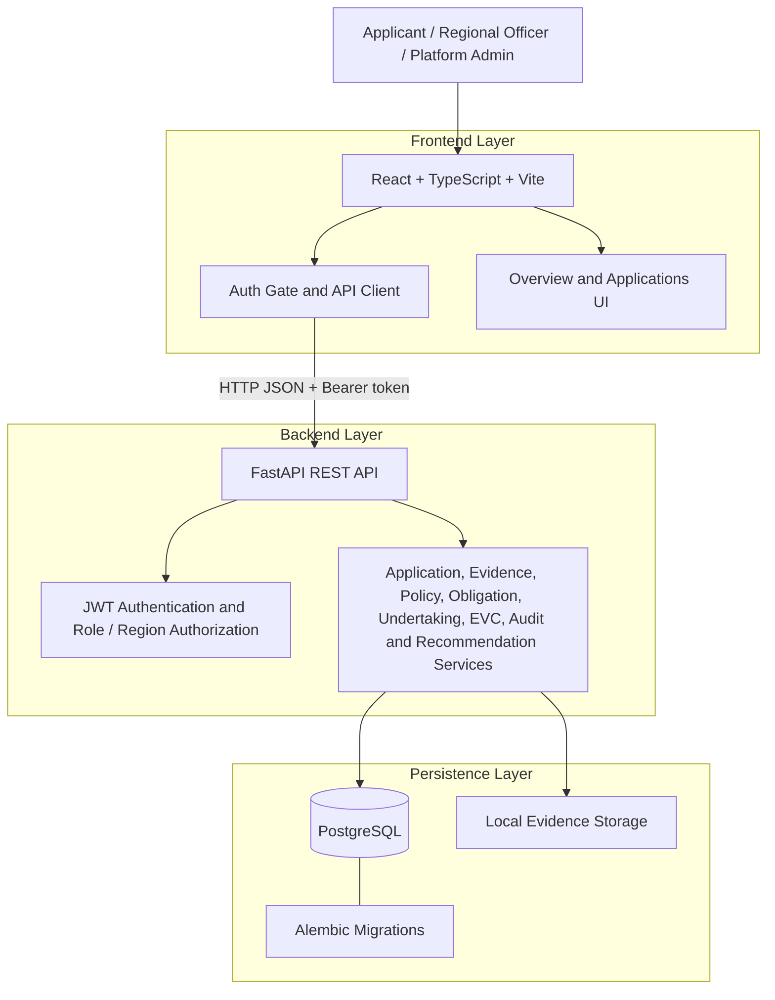

# PRAVAAH-2: Project and Architecture Brief

> **Purpose:** Source document for preparing a project presentation, technical PPT, demo narration, and architecture slides.
>
> **Accuracy rule:** This brief separates implemented backend capabilities, frontend-connected workflows, and work still outstanding. Do not present an API as a finished user-facing feature unless the interface is connected and verified.

## 1. Project Overview

**Project name:** PRAVAAH-2  
**Meaning:** PRAVAAH (प्रवाह) represents a structured flow of applications, review, evidence, and compliance-related work.  
**Problem context:** SIH26262, focused on improving the handling of AICTE-related approval workflows, compliance monitoring, evidence review, and operational follow-up.  
**Repository:** https://github.com/sainithinreddy06/PRAVAAH-2

PRAVAAH-2 is an independent workflow platform prototype designed to organize approval application records, review transitions, supporting evidence, obligations, undertakings, audit queries, and explainable compliance-readiness guidance in one system.

**Important positioning:** PRAVAAH-2 is not an official AICTE system. It does not issue official approval or compliance decisions, and its current policy metadata is not verified official AICTE guidance.

## 2. Problem Statement

Approval and compliance workflows can involve multiple actors, supporting documents, review stages, obligations, deadlines, and follow-up actions. When these activities are fragmented across tools or handled manually, it can be difficult to maintain a clear view of application status, evidence gaps, pending obligations, and the reasons behind workflow changes.

PRAVAAH-2 explores a structured digital workflow that can:
- Maintain application records and explicit status transitions.
- Restrict access according to user role and regional scope.
- Associate evidence and review outcomes with applications.
- Track obligations and undertakings.
- Provide operational summaries and filtered audit queries.
- Explain rule-based follow-up recommendations instead of presenting an unexplained score.

These are intended workflow improvements. Any quantified impact must be measured through a real evaluation; no performance improvement or time-saving percentage is claimed here.

## 3. Goals and Scope

### Primary goals
1. Provide a consistent application lifecycle.
2. Enforce authentication and server-side authorization.
3. Keep evidence, obligations, undertakings, and review activity associated with application records.
4. Make operational status and follow-up needs easier to inspect.
5. Expose understandable rule-based recommendations with explicit contributing factors.
6. Establish a maintainable frontend/backend architecture with database migrations and automated checks.

### Intended users and roles
The backend contains role- and region-aware access checks. Exact permissions are enforced by the API, not by frontend menu visibility.

- **Applicant:** works with applications within the ownership rules.
- **Regional officer/reviewer:** reviews records within the permitted regional scope.
- **Platform administrator:** has broader administrative scope for selected operations.

Use the backend role definitions and authorization tests when describing exact permissions. Do not claim a complete user-administration interface: no user/officer management API is currently registered.

## 4. Implemented Capabilities

This section describes capabilities present in the repository. It does not imply that every capability has a dedicated, connected frontend page.

### 4.1 Authentication and access control
- Login endpoint accepts email and password.
- Password verification uses Argon2.
- API issues signed JWT access tokens.
- The authenticated user is reloaded for requests so inactive users can be rejected and role/region values come from the database.
- User creation is an operator-managed CLI workflow. There is no public self-registration endpoint.
- Application access and review actions use role, ownership, and region checks.

**Frontend connection:** The sign-in gate calls the backend login and current-user endpoints. The browser keeps the access token in module memory, so a page refresh requires signing in again. A production-grade session design still needs review.

### 4.2 Application workflow
- Create and list applications.
- Retrieve an application through the API.
- Move applications through a controlled status state machine.
- Current statuses: `draft`, `submitted`, `under_review`, `changes_requested`, `approved`, and `rejected`.
- Transitions require a reason.
- The backend validates allowed transitions and access permissions.

**Frontend connection:** The application page supports API-backed listing, status filtering, draft creation, supported transition actions, refresh, and loading/error/empty feedback. A dedicated application-detail experience remains outstanding.

### 4.3 Policy metadata and evidence
- List policy metadata and create policy versions through authorized API endpoints.
- Upload application-linked PDF, JPEG, or PNG evidence within configured size limits.
- Calculate and store a SHA-256 digest for uploaded files.
- List evidence metadata for an application.
- Allow authorized officers to record evidence review outcomes.

**Limitations:** Policy metadata is not verified official AICTE guidance. The current default evidence storage is local disk. File type/signature checks are not malware scanning. Private durable object storage, encryption, malware scanning, retention controls, and signed access URLs remain production-hardening work.

### 4.4 Obligations and notifications
- Create application-linked obligations.
- List obligations with status/due-date filters and pagination.
- Update obligations with audit-event recording.
- Trigger overdue-obligation escalation through an API endpoint.
- Queue idempotent in-app notifications and expose a user's notification inbox.

**Limitations:** Escalation is API-triggered, not an automatically scheduled background process. Email/SMS delivery and retry workers are not implemented. A queued notification must not be described as delivered.

### 4.5 Undertakings and EVC readiness
- Create draft undertakings associated with applications.
- List, submit, and review undertakings.
- Record accept, reject, or request-changes outcomes through the review API.
- Create timestamped EVC assessment snapshots based on evidence counts, open obligations, and unaccepted undertakings.
- Retrieve assessment history for an application.

**Limitations:** EVC outputs are workflow-readiness indicators, not official compliance verdicts. Assessments are snapshots and may need to be regenerated after underlying records change. A dedicated EVC/undertakings UI is not yet connected.

### 4.6 Audit queries and operational metrics
- Query audit events with entity, action, actor, date, and pagination filters.
- Apply regional scoping for regional officers and broader access for platform administrators.
- Return operational counts for applications, evidence, obligations, undertakings, and overdue obligations.

**Limitations:** Audit events are not yet established as tamper-evident immutable records. Operational counts do not represent official compliance statistics. Dedicated audit and metrics screens remain outstanding.

### 4.7 Explainable recommendations
- Evaluate implemented rules for evidence gaps, rejected or pending evidence, overdue or near-due obligations, and undertakings that have not been accepted.
- Return a rule-based risk score/level, contributing factors, and recommended next actions.
- Restrict access and scope results through the backend.

**Limitations:** This is a transparent rules-based heuristic, not a trained machine-learning prediction model, an official AICTE scoring rubric, or an approval decision. Officers must validate requirements against authoritative sources.

### 4.8 Public information pages
- Public landing page with a workflow explanation and a clearly illustrative, non-live interface representation.
- Privacy and terms routes exist as review drafts.

**Limitations:** The privacy policy and terms are not ready for final publication until they have been checked against actual data handling and legal requirements. The illustrative landing-page interface must not be represented as a live operational dashboard.

## 5. Frontend Integration Status

| Area | Current status |
|---|---|
| Public landing page | Implemented as a public page; browser/responsive verification remains necessary |
| Sign-in and current-user gate | Connected to authentication API; runtime and browser journey verification outstanding |
| Overview | Requests application records from the API and displays response-scoped counts and recent records |
| Applications list | API-connected with status filtering and refresh |
| Create draft application | Connected to backend API |
| Application transitions | Connected to backend API with a reason prompt and error/conflict feedback |
| Application detail | No dedicated detail UI yet |
| Evidence upload/list/review | Backend endpoints exist; dedicated frontend workflow not connected |
| Policy register | Backend endpoints exist; dedicated frontend workflow not connected |
| Obligations and notifications | Backend endpoints exist; dedicated frontend workflow not connected |
| Undertakings and EVC | Backend endpoints exist; dedicated frontend workflow not connected |
| Audit events and operational metrics | Backend endpoints exist; dedicated frontend views not connected |
| Recommendations | Backend endpoint exists; dedicated frontend view not connected |
| Institution/officer administration | No matching management API registered |
| Configurable workflow studio | No workflow-configuration API identified |
| Persisted settings | No workspace preferences API identified |

Some route paths redirect to the overview rather than implementing the feature. Do not show these as completed screens in a PPT.

## 6. System Architecture

### High-level architecture



### Layer responsibilities

**1. Presentation layer**
- React, TypeScript, Vite, Tailwind CSS.
- React Router routes public and authenticated views.
- Lucide icons are used for interface iconography.
- Current connected workspace views: overview and applications.
- API client centralizes URL configuration, bearer-token handling, response parsing, and API errors.

**2. API and application layer**
- FastAPI exposes versioned REST endpoints under `/api/v1`.
- Pydantic schemas validate request and response payloads.
- Route modules separate authentication, applications, compliance/evidence/policy, obligations, EVC/undertakings, operations/audit, recommendations, and health checks.
- Backend dependencies enforce authenticated identity and authorization rules.
- OpenAPI documentation is available in development at `/docs`.

**3. Data layer**
- PostgreSQL stores relational application and workflow data.
- SQLAlchemy provides database models and persistence access.
- Alembic manages versioned schema migrations.
- Evidence files currently use configured local storage, while file metadata and SHA-256 digests are handled by the backend.
- Docker volumes persist local development database and evidence data across container restarts.

**4. Operational and quality layer**
- Docker Compose runs PostgreSQL, a migration job, and the API.
- GitHub Actions frontend CI runs TypeScript checks, ESLint, and a Vite production build.
- GitHub Actions backend CI validates the migration graph, applies migrations against PostgreSQL, runs pytest, and checks Ruff lint.
- Health and readiness endpoints distinguish API liveness from database readiness.

## 7. Technology Stack

| Layer | Technology | Role |
|---|---|---|
| Frontend | React + TypeScript | Component-based user interface |
| Build and development | Vite | Local development server and production build |
| Styling | Tailwind CSS and project CSS | Layout, responsive styling, interface states |
| Routing | React Router | Public and workspace routes |
| Icons | Lucide React | Consistent interface icons |
| API | Python + FastAPI | Versioned REST endpoints |
| Validation | Pydantic | API payload validation and schemas |
| ORM | SQLAlchemy | Relational data access |
| Database | PostgreSQL 16+ | Persistent structured application data |
| Migrations | Alembic | Versioned schema changes |
| Authentication | Argon2 + signed JWT | Password hashing and bearer access tokens |
| Evidence integrity | SHA-256 digest | File integrity reference, not proof of authenticity |
| Containers | Docker + Docker Compose | Local multi-service environment |
| CI | GitHub Actions | Automated frontend/backend quality checks |
| Testing/lint | pytest + Ruff + ESLint + TypeScript | Automated checks and static quality validation |

No external AI model or trained ML pipeline is required for the current rule-based recommendation endpoint. Do not describe the current recommendation logic as AI/ML prediction.

## 8. Backend API Map

Base prefix: `/api/v1`

| Module / area | Representative endpoints | Purpose |
|---|---|---|
| Health | `GET /health`, `GET /ready` | Liveness and database readiness |
| Authentication | `POST /auth/login`, `GET /auth/me` | Login and current authenticated profile |
| Applications | `POST /applications`, `GET /applications`, application detail and transition routes | Application lifecycle |
| Policies | `GET /policies`, `POST /policies` | Policy metadata/versioning |
| Evidence | Application-scoped evidence upload/list and evidence review route | Evidence handling and review |
| Obligations | `POST /obligations`, `GET /obligations`, update and escalation routes | Due-date tracking and notification queueing |
| Notifications | `GET /notifications` | Current-user notification inbox |
| Undertakings | Create, list, submit, and review routes | Undertaking lifecycle |
| EVC | Assessment creation and application assessment history routes | Readiness snapshots |
| Operations | `GET /audit/events`, `GET /operations/metrics` | Audit querying and operational summaries |
| Recommendations | Application-scoped recommendations route | Explainable rules-based next actions |

Consult the route modules and backend README for exact request schemas, parameters, response formats, and authorization requirements before including detailed API examples in a technical presentation.

## 9. Main Data Concepts

The current schema and route modules cover these domain concepts:

- **User:** identity, active status, role, and region.
- **Institution:** institution identity and region association.
- **Application:** reference code, institution, submitting user, workflow stage, status, and timestamps.
- **Policy metadata/version:** versioned policy records; not necessarily authoritative policy content.
- **Evidence:** application association, metadata, review state, and SHA-256 digest.
- **Obligation:** application association, due date, status, and operational follow-up.
- **Notification:** user inbox item and queue/delivery state.
- **Undertaking:** application association and submission/review state.
- **EVC assessment:** timestamped readiness snapshot.
- **Audit event:** actor/action/entity context for operational review.

Use the actual SQLAlchemy models and Alembic migrations as the source of truth for detailed field lists and relationships. Avoid inventing a schema diagram with unverified columns or relationships.

## 10. Key Workflow for a Demo

A realistic demo can focus on the connected application slice:

1. Start PostgreSQL and the API using Docker Compose.
2. Create a local institution through the operator provisioning script.
3. Create a test user with an appropriate role and matching region.
4. Start the frontend and configure its API base URL.
5. Sign in with the provisioned user.
6. View the application overview returned by the API.
7. Open the Applications page and create a draft application using a valid institution ID and reference code.
8. Demonstrate the supported status filter.
9. Submit an allowed transition and provide the required reason.
10. Show API feedback for loading, empty, validation, or conflict states as appropriate.

Evidence, obligations, undertakings, EVC, audit, and recommendation endpoints can be shown as backend/API capabilities only until their frontend flows and end-to-end behavior have been verified.

## 11. Local Development

### Prerequisites
- Docker Desktop with Docker Compose.
- Node.js 20 or later.
- Python 3.12+ if running the backend outside Docker.

### Start database, migrations, and API
```bash
docker compose up --build
```

### Create test data
Create the institution first, record its ID and region, then create a user with a matching region.

```bash
docker compose exec api python -m scripts.create_institution
docker compose exec api python -m scripts.create_user
```

### Start the frontend in a separate terminal
```bash
npm install
npm run dev
```

Default local addresses:
- Frontend: `http://localhost:5173`
- API: `http://localhost:8000`
- API docs: `http://localhost:8000/docs`
- Liveness: `http://localhost:8000/api/v1/health`
- Readiness: `http://localhost:8000/api/v1/ready`

The frontend API base can be configured with `VITE_API_BASE_URL`; the local default is `http://127.0.0.1:8000`.

**Security note:** Compose defaults are development-only. Use strong managed secrets for any deployed environment. Never expose development credentials or secrets in a presentation, repository, or public deployment.

## 12. Verification Status

### Automated checks
The repository has GitHub Actions checks for the frontend and backend. Previously observed successful runs include:
- Frontend typecheck, lint, and production build: [run 40122685895](https://github.com/sainithinreddy06/PRAVAAH-2/actions/runs/40122685895)
- Backend migrations, PostgreSQL migration application, tests, and Ruff: [run 40122629323](https://github.com/sainithinreddy06/PRAVAAH-2/actions/runs/40122629323)
- Institution provisioning checks: [run 40122783060](https://github.com/sainithinreddy06/PRAVAAH-2/actions/runs/40122783060)

These runs apply to the commits that triggered them. They are not proof that every later commit was re-tested or that the full application works end to end.

### Still requires verification
- Full browser journey for sign-in, application creation, listing, and transitions.
- Live frontend-to-backend integration and clean Docker Compose startup.
- Applicant ownership and regional authorization boundaries through real requests.
- Evidence upload/review behavior and secure production storage.
- Automated/scheduled notification delivery and retries.
- Production session security, secrets management, monitoring, backups, and deployment configuration.
- Final review of privacy and terms pages against actual data handling.
- Official policy/data integration and institutional validation.

## 13. Security, Privacy, and Reliability Considerations

Current controls include password hashing, signed access tokens, server-side role/region checks, input validation, controlled application transitions, evidence size/type checks, and API tests.

Important remaining work includes:
- Review of browser token/session handling and production authentication design.
- Managed production secrets and secure deployment configuration.
- Private durable evidence storage, encryption, malware scanning, access controls, and retention policies.
- Tamper-evident audit design and operational monitoring.
- Backup, restore, incident response, and service-level planning.
- Verification that public privacy/terms statements accurately reflect actual data processing.

Do not claim complete production security or regulatory compliance based solely on the existing controls.

## 14. Current Limitations and Roadmap

### Priority 0: Verify the connected slice
- Run clean Docker Compose startup.
- Test login, current-user loading, application creation/listing, and transitions in a browser.
- Test invalid credentials, API errors, transition conflicts, ownership, and regional isolation.
- Verify the latest commit's CI results.

### Priority 1: Connect existing backend workflows
- Application detail and scrutiny workflow.
- Evidence upload, list, and review.
- Policy metadata listing and authorized version creation.
- Obligations and notification inbox.
- Undertakings and EVC assessment history.
- Audit event and operational metrics views.
- Explainable recommendations view.

### Priority 2: Define missing product APIs and production controls
- Specify institution and officer administration before building those screens.
- Decide whether workflow configuration and persisted workspace settings are required.
- Implement private evidence storage and malware scanning.
- Add scheduled notification workers, delivery retries, and monitoring if required.
- Strengthen audit integrity, backup/restore, session security, and deployment controls.
- Integrate verified authoritative policy data only after source, licensing, freshness, and review processes are defined.

## 15. Suggested PPT Structure

1. **Title:** PRAVAAH-2, structured approval and compliance workflow prototype.
2. **Problem:** fragmented application, evidence, review, and follow-up workflows.
3. **Proposed solution:** a traceable workflow across application status, evidence, obligations, and review.
4. **Users and workflow:** applicant, regional officer, platform administrator; show one verified application journey.
5. **Features:** clearly split API-implemented capabilities from frontend-connected capabilities.
6. **Architecture:** use the high-level architecture diagram in Section 6.
7. **Technology stack:** use Section 7.
8. **Data and API design:** use Sections 8 and 9.
9. **Security and quality:** describe current controls and automated checks without overstating verification.
10. **Demo and implementation status:** show the connected application slice and identify backend-only features.
11. **Limitations and roadmap:** use Section 14.
12. **Conclusion:** PRAVAAH-2 establishes a modular workflow foundation; broader UI integration, runtime validation, official data validation, and production hardening remain necessary.

## 16. Presentation Accuracy Checklist

Before finalizing slides, confirm:
- [ ] Every screenshot comes from the current running application or is clearly labelled as an illustration.
- [ ] No fake metrics, fabricated user counts, testimonials, reviews, or measured impact claims are included.
- [ ] Backend endpoints are not presented as completed frontend screens.
- [ ] Rule-based recommendations are not described as trained AI/ML predictions.
- [ ] EVC snapshots are not described as official compliance decisions.
- [ ] Queued notifications are not described as delivered messages.
- [ ] Audit events are not described as tamper-proof or immutable.
- [ ] Policy metadata is not described as verified official AICTE policy.
- [ ] CI success is distinguished from live end-to-end verification.
- [ ] Any future feature is explicitly labelled as planned rather than implemented.

---

**Source of truth:** Repository code, backend README, integration coverage matrix, implementation checklist, API schemas, SQLAlchemy models, Alembic migrations, and the latest CI runs. If this brief and the code disagree, inspect the current code and update the brief before presenting.
